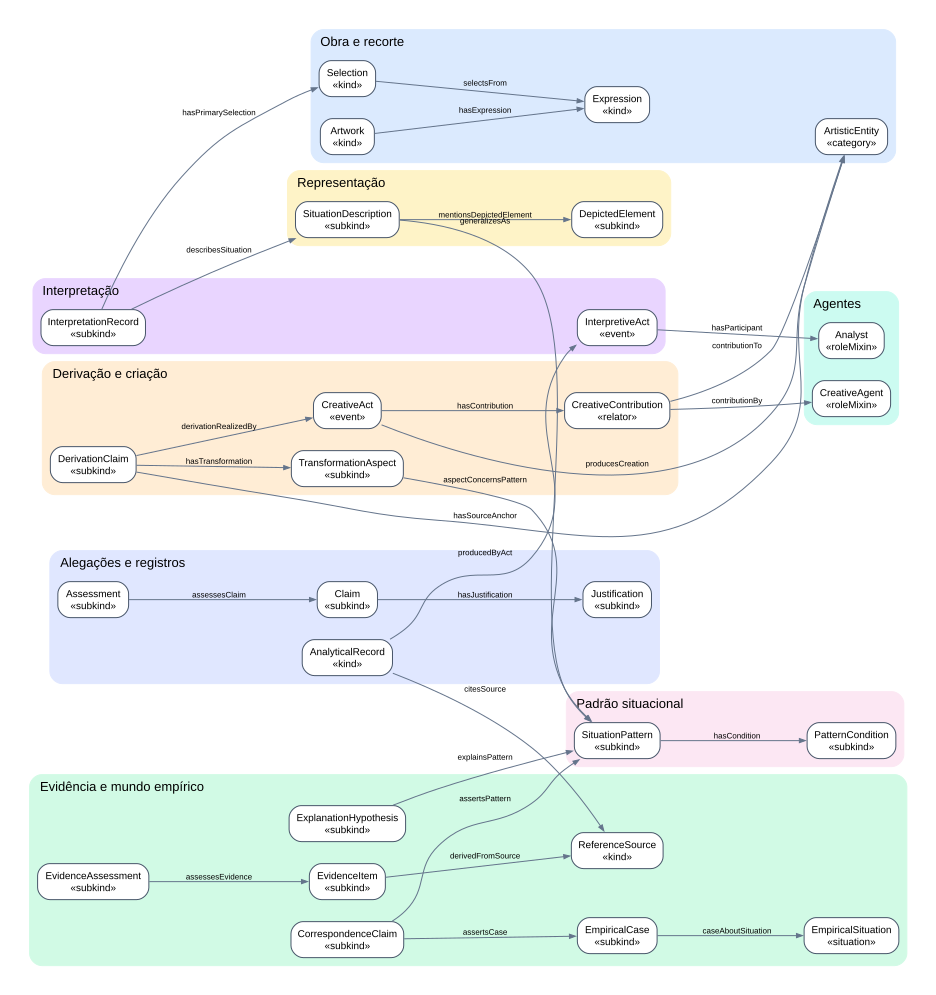

# Ontologia de Arte e Realidade (ARO)

     

> 🇺🇸 **[Read this documentation in English](README.md)** · 🇧🇷 Português (esta página)

> ⚠️ **Beta — em desenvolvimento.** A versão 0.2.0 é um rascunho de pesquisa de um projeto de doutorado (PPGInf/UFPR, ver [vinculação](#vinculação-acadêmica-e-institucional)); termos e arquivos ainda podem mudar.

A **ARO** é uma ontologia OWL para descrever **obras de arte em qualquer mídia** (música, texto, imagem, vídeo…) e o que se diz sobre elas, de forma rastreável e contestável:

- **o que se interpreta** num trecho de uma obra, admitindo interpretações divergentes;
- **que situações a obra representa** e que **padrões** essas situações formam;
- **que casos reais se parecem** com esses padrões, apoiados por fontes e evidências;
- **como uma obra deriva de outra** (tradução, cover, sample, adaptação, paródia, obra de fã…), o que foi mantido ou transformado, quem criou e **por que** se afirma a derivação.

A ARO é uma representação: ela não decide nem verifica nada. Interpretações, correspondências com a realidade e derivações são representadas como **alegações feitas por agentes**, junto com suas justificativas, fontes e avaliações de evidência, que outros agentes podem apoiar ou contestar. A ontologia nunca afirma por si que uma alegação é verdadeira, e a legalidade ou originalidade das derivações está fora do seu escopo.

---

## Sumário

- [Documentação](#documentação)
- [Como a ontologia está organizada](#como-a-ontologia-está-organizada)
- [Princípios](#princípios)
- [Instalação](#instalação)
- [Usar a ontologia](#usar-a-ontologia)
- [Instanciar: passo a passo](#instanciar-passo-a-passo)
- [Validar e consultar seus dados](#validar-e-consultar-seus-dados)
- [Anotador (ferramenta web)](#anotador-ferramenta-web)
- [Formato para ferramentas de anotação](#formato-para-ferramentas-de-anotação)
- [Executar os testes](#executar-os-testes)
- [Classes](#classes)
- [Idiomas](#idiomas)
- [Estrutura do repositório](#estrutura-do-repositório)
- [Alterar o modelo](#alterar-o-modelo)
- [Vinculação acadêmica e institucional](#vinculação-acadêmica-e-institucional)
- [Status, licença e citação](#status-licença-e-citação)

---

## Documentação

A documentação completa está disponível nos dois idiomas:

| Documento | 🇧🇷 Português | 🇺🇸 English |
|---|---|---|
| Propósito e escopo | [Português](docs/pt-BR/purpose-and-scope.md) | [English](docs/en/purpose-and-scope.md) |
| Requisitos | [Português](docs/pt-BR/requirements.md) | [English](docs/en/requirements.md) |
| Questões de competência | [Português](docs/pt-BR/competency-questions.md) | [English](docs/en/competency-questions.md) |
| Modelo de referência (todas as classes, relações, vocabulários) | [Português](docs/pt-BR/reference-model.md) | [English](docs/en/reference-model.md) |
| Tipologia de derivação e bibliografia | [Português](docs/pt-BR/derivation-typology.md) | [English](docs/en/derivation-typology.md) |
| Fundamentação, mapeamentos e limitações | [Português](docs/pt-BR/foundation-and-mappings.md) | [English](docs/en/foundation-and-mappings.md) |
| Decisões de projeto (ADR-001 a ADR-024) | [Português](docs/pt-BR/design-decisions.md) | [English](docs/en/design-decisions.md) |
| Tipos de dados e validação | [Português](docs/pt-BR/datatypes-and-validation.md) | [English](docs/en/datatypes-and-validation.md) |
| Estudos de caso (Homem na Estrada, Vidas Secas) | [Português](docs/pt-BR/case-studies.md) | [English](docs/en/case-studies.md) |
| Diagramas OntoUML | [Português](docs/pt-BR/ontouml.md) | [English](docs/en/ontouml.md) |
| Rastreabilidade | [Português](docs/pt-BR/traceability.md) | [English](docs/en/traceability.md) |
| Plano SABiOx | [Português](docs/pt-BR/sabiox-plan.md) | [English](docs/en/sabiox-plan.md) |
| Compilado SABiOx (tudo por fase) | [Português](docs/pt-BR/sabiox-compilado.md) | [English](docs/en/sabiox-compilation.md) |
| Manual do anotador (passo a passo) | [Português](docs/pt-BR/manual-anotador.md) | [English](docs/en/annotator-manual.md) |
| Guia do anotador | [Português](annotator/README.md#português) | [English](annotator/README.md#english) |
| Guia de uso (este arquivo) | [Português](LEIA-ME.md) | [English](README.md) |
| Versões congeladas (releases) | [Português](releases/README.md) | [English](releases/README.md) |
| Histórico de versões | — (só em inglês) | [English](CHANGELOG.md) |

---

## Como a ontologia está organizada

São seis módulos (caixas coloridas). Cada seta é uma relação da ontologia; setas que terminam na borda de uma caixa apontam para qualquer classe daquele módulo (por exemplo, a âncora de uma derivação pode ser obra, manifestação ou recorte). O [diagrama completo](model/diagrams/overview.svg) mostra todas as classes e relações.



| Módulo | Para quê | Diagrama |
|---|---|---|
| **Obra e recorte** | Identificar a obra, suas versões (gravação, edição, montagem) e trechos endereçáveis | [artwork](model/diagrams/artwork.svg) |
| **Interpretação** | Registrar interpretações de recortes, quem as fez, com que argumentos, contestações e avaliações | [interpretation](model/diagrams/interpretation.svg) |
| **Representação** | Descrever situações, personagens e estados intencionais representados | [representation](model/diagrams/representation.svg) |
| **Padrão** | Generalizar situações em padrões reutilizáveis entre obras | [pattern](model/diagrams/pattern.svg) |
| **Evidência** | Ligar padrões a casos reais por alegações apoiadas em fontes e avaliações | [evidence](model/diagrams/evidence.svg) |
| **Derivação** | Dizer que uma obra/versão/trecho deriva de outro, como, o que mudou, quem fez e por quê | [derivation](model/diagrams/derivation.svg) |

## Princípios

1. **Recorte não é interpretação.** O trecho é um endereço; o sentido fica num `InterpretationRecord` separado.
2. **Representado não é empírico.** A situação na obra (`SituationDescription`) é distinta da situação real (`EmpiricalSituation`).
3. **Interpretações podem conflitar** e coexistir.
4. **Padrões são reutilizáveis** entre obras independentes.
5. **Fontes são independentes e reutilizáveis**; cada `EvidenceItem` representa um extrato contextual, e uma `EvidenceAssessment` representa o julgamento de um agente sobre se ele apoia ou contesta uma alegação **específica**.
6. **Uma alegação de correspondência representa semelhança**, não identidade nem causalidade.
7. **Derivação é representada como alegação**, não como fato; cada elo de uma cadeia de derivação é uma alegação separada, e nenhum axioma de transitividade é declarado.
8. **Obras derivadas são representadas como criações por direito próprio**; legalidade e originalidade estão fora do escopo da ontologia.
9. **Agentes vêm de fora**: pessoas, bandas e analistas são IRIs de outras ontologias (schema.org, FOAF, Wikidata, PROV-O).

## Instalação

Requisitos: **Python 3.10+**. Opcional: **Graphviz**, só para regenerar os diagramas SVG.

```bash
git clone <url-do-repositório> artistic-reality-ontology
cd artistic-reality-ontology
python -m pip install -r requirements.txt
python tests/test_project.py
```

O último comando deve terminar com `PASS: ...`. As dependências são `rdflib`, `jsonschema` e `pyshacl`.

## Usar a ontologia

| Arquivo | Uso |
|---|---|
| [`ontology/src/aro.ttl`](ontology/src/aro.ttl) | Versão em desenvolvimento em Turtle (também [`aro.owl`](ontology/src/aro.owl) em RDF/XML e [`aro.jsonld`](ontology/src/aro.jsonld)); um arquivo por pacote em [`ontology/src/modules/`](ontology/src/modules/) |
| [`releases/v0.2.0-beta/`](releases/v0.2.0-beta/) | **Versão congelada para citar** (IRI de versão `https://w3id.org/aro/ontology/0.2.0-beta`); todas as versões em [`releases/`](releases/README.md) |
| [`validation/aro-shapes.ttl`](validation/aro-shapes.ttl) | Restrições SHACL para validar dados |
| [`schemas/derivation-annotation.schema.json`](schemas/derivation-annotation.schema.json) | Formato JSON para ferramentas de anotação |

- **Namespace:** `https://w3id.org/aro/ontology#` (prefixo `aro:`).
- **Protégé ou outro editor OWL:** abra `ontology/src/aro.ttl`. Em *Preferences → Renderer*, escolha exibir por rótulo e idioma `pt-BR` para ver os termos em português.
- **Python:**

```python
from rdflib import Graph
g = Graph().parse("ontology/src/aro.ttl")
g.parse("meus-dados.ttl")
```

## Instanciar: passo a passo

O exemplo completo está em [`examples/quickstart.ttl`](examples/quickstart.ttl).

**1. Obra, manifestação e recorte.** A obra é abstrata; a manifestação é uma versão concreta; o recorte aponta um trecho com um seletor W3C Web Annotation (`t=` tempo, `xywh=` região, citação de texto ou SVG).

```turtle
@prefix aro:    <https://w3id.org/aro/ontology#> .
@prefix oa:     <http://www.w3.org/ns/oa#> .
@prefix schema: <https://schema.org/> .
@prefix ex:     <https://example.org/my-project/> .

ex:song a aro:Artwork ; aro:textValue "Song A"@en, "Canção A"@pt-BR .
ex:song-rec a aro:Manifestation ; aro:realizesArtwork ex:song .
ex:riff a aro:Selection ; aro:selectsFrom ex:song-rec ; aro:hasSelector ex:riff-sel .
ex:riff-sel a oa:FragmentSelector ; oa:value "t=12,16" .
```

**2. Interpretação.** Ancorada num recorte e produzida por um ato com um participante. O analista é qualquer IRI externo.

```turtle
ex:me a schema:Person .
ex:act a aro:InterpretiveAct ; aro:hasParticipant ex:me .
ex:reading a aro:InterpretationRecord ;
  aro:hasPrimarySelection ex:riff ;
  aro:producedByAct ex:act ;
  aro:describesSituation ex:scene .
ex:scene a aro:SituationDescription ;
  aro:textValue "A character leaves home after a conflict."@en,
                "Uma personagem sai de casa após um conflito."@pt-BR .
```

**3. Derivação.** Uma faixa nova usa o riff como sample. O nível (obra, manifestação ou recorte) é escolhido pelas âncoras; tipo, regime, dimensão e operação são conceitos dos vocabulários; a justificativa explica a alegação.

```turtle
ex:track a aro:Artwork .
ex:track-rec a aro:Manifestation ; aro:realizesArtwork ex:track .
ex:loop a aro:Selection ; aro:selectsFrom ex:track-rec ; aro:hasSelector ex:loop-sel .
ex:loop-sel a oa:FragmentSelector ; oa:value "t=0,4" .

ex:claim a aro:DerivationClaim ;
  aro:hasSourceAnchor ex:riff ;
  aro:hasDerivedAnchor ex:loop ;
  aro:hasDerivationType aro:Sampling ;
  aro:hasRegime aro:PlayfulRegime ;
  aro:hasTransformation ex:aspect ;
  aro:derivationJustifiedBy ex:why .
ex:aspect a aro:TransformationAspect ;
  aro:hasDimension aro:RecordedSoundDimension ;
  aro:hasOperation aro:Recontextualized .
ex:why a aro:InterpretiveJustification ;
  aro:textValue "Same 4-second guitar riff, pitched up."@en,
                "Mesmo riff de guitarra de 4 segundos, mais agudo."@pt-BR .
```

**Mais exemplos:**
- [`examples/synthetic-derivation.ttl`](examples/synthetic-derivation.ttl): cover com contribuições criativas, adaptação de romance para filme que mantém um padrão, cadeia fanfic → filme → romance, fontes e avaliação de evidência.
- [`examples/example_homem_na_estrada.ttl`](examples/example_homem_na_estrada.ttl) e [`examples/example_vidas_secas.ttl`](examples/example_vidas_secas.ttl): um arquivo por obra (gerados por `scripts/split_examples.py`).
- [`examples/case-studies.ttl`](examples/case-studies.ttl): **estudos de caso reais** — *Homem na Estrada* (Racionais MC's) e *Vidas Secas* (Graciliano Ramos) com sua adaptação para o cinema, ligados a casos reais e fontes documentadas; ver [estudos de caso](docs/pt-BR/case-studies.md).
- [`examples/synthetic-data.ttl`](examples/synthetic-data.ttl): cadeia completa obra → interpretação → padrão → caso real → evidência.

**Onde achar os conceitos:** os valores de `hasDerivationType`, `hasRegime`, `hasDimension`, `hasOperation` e `contributionRole` estão na [tabela de vocabulários](#classes) abaixo e, com definições e literatura, em [docs/pt-BR/reference-model.md](docs/pt-BR/reference-model.md#vocabulários-controlados-skos).

## Validar e consultar seus dados

```bash
python scripts/validate.py meus-dados.ttl --lang pt-BR
```

Mostra `OK` ou uma linha por violação (recurso, propriedade e mensagem em português). Exemplos de erros apontados: derivação sem tipo, origem igual à derivada, âncora que não é obra/manifestação/recorte, texto sem marcação de idioma.

```bash
python scripts/query.py meus-dados.ttl --query queries/CQ-13-derivations-of-work.rq
```

Executa uma consulta SPARQL sobre seus dados mais a ontologia. As consultas prontas em [`queries/`](queries/) respondem às questões de competência:

| Consulta | Pergunta |
|---|---|
| CQ-05 | Que casos reais foram alegados semelhantes a um padrão? |
| CQ-06 | Que fontes uma alegação de correspondência cita? |
| CQ-13 | O que deriva de uma obra, em que nível e de que tipo? |
| CQ-14 | Que obras estão ligadas por cadeias de derivação? |
| CQ-15 | O que cada derivação mantém, modifica, acrescenta, remove ou recontextualiza? |
| CQ-16 | Que derivações mantêm um padrão situacional da origem? |
| CQ-17 | Como cada derivação é explicada (justificativas, fontes, avaliações)? |
| CQ-18 | Quem contribuiu para a criação derivada e com que papel? |
| RQ-01 | Que trechos representam situações alegadas correspondentes a casos reais documentados, e onde está a fonte? |
| RQ-02 | Que padrões situacionais se repetem em obras independentes? |
| RQ-03 | Como cada correspondência é sustentada (evidência, fonte, avaliação)? |
| RQ-04 | Que derivações mantêm um padrão da origem que corresponde a casos reais? |

## Anotador (ferramenta web)

A pasta [`annotator/`](annotator/README.md) traz uma ferramenta no navegador para instanciar a ARO sem escrever Turtle:

```bash
python scripts/annotator.py
```

Crie nós de qualquer classe, ligue-os com as propriedades que a ontologia permite (inclusive conceitos de vocabulário, seletores W3C e agentes externos), escreva textos em vários idiomas, adicione links para fontes e evidências, pesquise situações no Google, abra o grafo passo a passo, valide e **salve ou carregue** suas anotações em Turtle. Interface em português ou inglês. Ver o [manual do anotador](docs/pt-BR/manual-anotador.md) (passo a passo) e o [guia do anotador](annotator/README.md#português) (referência rápida).

## Executar os testes

```bash
python tests/test_project.py
```

A saída deve terminar com `PASS: ...`. Os testes conferem:
- que os arquivos gerados batem com o catálogo;
- que as três serializações OWL coincidem;
- que todo termo tem rótulo em inglês e português;
- os JSON Schemas e as restrições SHACL, com dados válidos e dados errados de propósito;
- cada consulta SPARQL;
- as respostas esperadas dos estudos de caso.

Detalhes: [manual do anotador, seção 12](docs/pt-BR/manual-anotador.md#12-executar-os-testes-do-projeto).

## Formato para ferramentas de anotação

Um anotador pode produzir JSON validado por [`schemas/derivation-annotation.schema.json`](schemas/derivation-annotation.schema.json): uma alegação de derivação por documento, com âncoras e seletores, tipos, regimes, aspectos e justificativa em um ou vários idiomas (`{"en": "...", "pt-BR": "..."}`). Os valores aceitos são gerados dos vocabulários da ontologia. Exemplo: [`examples/synthetic-derivation-annotation.json`](examples/synthetic-derivation-annotation.json).

## Classes

Visão geral gerada a partir do catálogo; a coluna UFO traz o estereótipo OntoUML. Para cada classe, [docs/pt-BR/reference-model.md](docs/pt-BR/reference-model.md) explica o que o estereótipo significa na UFO, como a classe é representada em OWL/TTL (com seu Turtle), suas restrições SHACL e o que o OWL não consegue expressar.

<!-- BEGIN GENERATED: class overview (scripts/build.py) -->
#### `artwork` — Obra e recorte

| Classe | Rótulo | UFO | Definição |
|---|---|---|---|
| `Artwork` | obra | «kind» | Criação artística identificável em diversas mídias e manifestações. |
| `Manifestation` | manifestação | «kind» | Expressão, versão ou realização específica de uma obra. |
| `Selection` | recorte | «kind» | Seleção endereçável de uma parte de manifestação (não componente físico). |
| `AnalysisUnit` | unidade de análise | «kind» | Agrupamento intencional de recortes com finalidade analítica. |

#### `interpretation` — Interpretação

| Classe | Rótulo | UFO | Definição |
|---|---|---|---|
| `InterpretationRecord` | registro de interpretação | «kind» | Registro autoral persistente de uma interpretação de recorte. |
| `InterpretiveAct` | ato interpretativo | «event» | Atividade intencional temporal que produz interpretações registradas. |
| `Analyst` | analista | «roleMixin» | Qualquer agente humano, identificado em vocabulário externo, na medida em que interpreta ou avalia. A identidade do agente é representada pelo vocabulário externo, não pela ARO. |
| `InterpretiveJustification` | justificativa interpretativa | «kind» | Argumento registrado que liga premissas a uma interpretação ou a uma alegação de derivação. |
| `InterpretationChallenge` | contestação de interpretação | «kind» | Crítica ou raciocínio alternativo registrado sobre interpretação. |
| `InterpretationAssessment` | avaliação de interpretação | «kind» | Julgamento epistêmico ou axiológico explícito de interpretação. |
| `AssessmentCriterion` | critério de avaliação | «kind» | Regra especificada de avaliação epistêmica ou de valores. |

#### `representation` — Representação

| Classe | Rótulo | UFO | Definição |
|---|---|---|---|
| `DepictedElement` | elemento representado | «kind» | Representação informacional de um referente na obra. |
| `DepictedAgent` | agente representado | «subkind» | Elemento representado que se refere a agente ou personagem. |
| `SituationDescription` | descrição de situação | «kind» | Descrição registrada de situação representada. |
| `IntentionalStateDescription` | descrição de estado intencional | «subkind» | Descrição de situação que atribui desejo, crença ou intenção a agente representado. |

#### `pattern` — Padrão situacional

| Classe | Rótulo | UFO | Definição |
|---|---|---|---|
| `SituationPattern` | padrão situacional | «kind» | Especificação informacional reutilizável de condições situacionais. |
| `PatternCondition` | condição de padrão | «kind» | Condição individualizada obrigatória ou opcional de um padrão. |

#### `evidence` — Evidência e mundo empírico

| Classe | Rótulo | UFO | Definição |
|---|---|---|---|
| `EmpiricalCase` | caso empírico | «kind» | Dossiê documentado sobre uma situação ou ocorrência real. |
| `EmpiricalClaim` | afirmação empírica | «kind» | Afirmação registrada e verificável acerca do mundo empírico. |
| `ReferenceSource` | fonte de referência | «kind» | Recurso externo citável: notícia, estudo, relatório, documento legal, relato, conjunto de dados etc. |
| `EvidenceItem` | item de evidência | «kind» | Afirmação ou observação contextualizada extraída de uma fonte. |
| `CorrespondenceClaim` | alegação de correspondência | «kind» | Alegação contestável de similaridade, instanciação ou relevância explicativa entre padrão e caso empírico. |
| `EvidenceAssessment` | avaliação de evidência | «kind» | Julgamento de apoio, contestação ou irrelevância de evidência para afirmação específica. |
| `ExplanationHypothesis` | hipótese explicativa | «kind» | Mecanismo ou fatores propostos para explicar fenômeno representado ou observado. |
| `EmpiricalSituation` | situação empírica | «situation» | Configuração de entidades e condições no mundo real. |
| `EmpiricalEvent` | evento empírico | «event» | Ocorrência do mundo real delimitada temporalmente. |

#### `derivation` — Derivação e criação

| Classe | Rótulo | UFO | Definição |
|---|---|---|---|
| `DerivationClaim` | alegação de derivação | «kind» | Alegação contestável, feita por um agente, de que uma entidade artística (obra, manifestação ou recorte) deriva de outra de modos especificados. A entidade derivada é representada como criação por direito próprio; legalidade e originalidade estão fora do escopo da ontologia. |
| `TransformationAspect` | aspecto de transformação | «kind» | Registro do que ocorreu com uma dimensão artística numa derivação (mantida, modificada, acrescentada, removida ou recontextualizada). |
| `CreativeAct` | ato criativo | «event» | Atividade intencional temporal que dá origem a uma obra ou manifestação, inclusive derivadas. |
| `CreativeAgent` | agente criativo | «roleMixin» | Qualquer agente, identificado e descrito em vocabulário externo (PROV-O, FOAF, schema.org, Wikidata...), na medida em que contribui para um ato criativo. A identidade do agente é representada pelo vocabulário externo, não pela ARO. |
| `CreativeContribution` | contribuição criativa | «relator» | Participação de um agente criativo num ato criativo sob um ou mais papéis. |
| `DerivationType` | tipo de derivação | «type» | Tipo de derivação (tradução, cover, sample, paródia...); suas instâncias são conceitos SKOS. |
| `DerivationRegime` | regime de derivação | «type» | Postura da derivação em relação à origem (lúdica, satírica, séria, reverencial); suas instâncias são conceitos SKOS. |
| `ArtisticDimension` | dimensão artística | «type» | Aspecto da obra segundo o qual a derivação pode ser comparada (melodia, letra, enredo, personagem, mídia...). |
| `TransformationOperation` | operação de transformação | «type» | O que a derivação faz com uma dimensão: manter, modificar, acrescentar, remover ou recontextualizar. |
| `CreativeRole` | papel criativo | «type» | Papel que qualifica uma contribuição criativa (compositor, intérprete, tradutor, remixador...). |

#### Vocabulários controlados (SKOS)

| Esquema | Conceitos | Nível mais alto |
|---|---|---|
| `DerivationTypeScheme` — Tipos de derivação | 40 | `Rerealization`, `Incorporation`, `Transformation`, `Imitation`, `Extension` |
| `ArtisticDimensionScheme` — Dimensões artísticas | 56 | `NarrativeDimension`, `TextDimension`, `MusicDimension`, `VisualDimension`, `AudiovisualDimension`, `GeneralDimension`, `ParatextDimension` |
| `DerivationRegimeScheme` — Regimes de derivação | 4 | `PlayfulRegime`, `SatiricalRegime`, `SeriousRegime`, `ReverentialRegime` |
| `TransformationOperationScheme` — Operações de transformação | 5 | `Retained`, `Modified`, `Added`, `Removed`, `Recontextualized` |
| `CreativeRoleScheme` — Papéis criativos | 10 | `AuthorRole`, `ComposerRole`, `LyricistRole`, `PerformerRole`, `ArrangerRole`, `TranslatorRole`, `AdapterRole`, `ProducerRole`, `DirectorRole`, `RemixerRole` |
<!-- END GENERATED: class overview -->

## Idiomas

- **Termos em inglês:** todos os IRIs (`aro:Artwork`, `aro:hasSourceAnchor`…).
- **Tradução completa em português:** toda classe, propriedade, conceito e mensagem de validação tem rótulo, definição e comentário em `@en` e `@pt-BR`.
- **Conteúdo em qualquer idioma:** textos dos seus dados (`aro:textValue`, `aro:derivationExtent`) devem ter marcação de idioma, por exemplo `"..."@es`, e podem ter um valor por idioma. Texto sem idioma é rejeitado na validação.

## Estrutura do repositório

| Pasta / arquivo | Conteúdo |
|---|---|
| `ontology/src/` | versão em desenvolvimento da ontologia (Turtle, RDF/XML, JSON-LD) e `modules/` por pacote — gerada |
| `releases/` | versões congeladas (`v0.1.0/`, `v0.2.0-beta/`…), cada uma com ontologia, módulos, SHACL e notas de versão |
| `validation/` | restrições SHACL — gerada |
| `schemas/` | JSON Schemas (fonte de referência, registro genérico, anotação de derivação) |
| `examples/` | dados sintéticos de exemplo, todos fictícios |
| `queries/` | consultas SPARQL das questões de competência |
| `annotator/` | anotador web (grafo, salvar/carregar Turtle) |
| `scripts/` | `build.py` (gera os artefatos), `validate.py`, `query.py`, `annotator.py`, `split_examples.py` |
| `model/` | catálogo conceitual (fonte única) e diagramas |
| `docs/` | documentação completa em `en/` e `pt-BR/` |
| `tests/` | verificação automatizada |

## Alterar o modelo

O arquivo [`model/conceptual-model.json`](model/conceptual-model.json) é a **fonte única**. Para acrescentar uma classe, relação ou conceito:

1. edite o catálogo (o `$comment` no topo explica cada campo);
2. rode `python scripts/build.py`, que regenera a ontologia, o SHACL, os schemas, a documentação de referência, os diagramas e a seção [Classes](#classes) deste arquivo;
3. rode `python tests/test_project.py`.

Não edite à mão os arquivos marcados como gerados.

## Vinculação acadêmica e institucional

Este projeto integra as atividades de pesquisa desenvolvidas no âmbito do Doutorado em Informática de **Jefferson Rodrigo Speck**, doutorando do Programa de Pós-Graduação em Informática (PPGInf) da Universidade Federal do Paraná (UFPR), sob orientação do **Prof. Dr. Roberto Pereira** (UFPR) e coorientação do **Prof. Dr. Clodis Boscarioli** (UNIOESTE), com vinculação ao Grupo de Pesquisa em Tecnologia e Inovação na Educação (GTIE), da Universidade Estadual do Oeste do Paraná (UNIOESTE).

A pesquisa de doutorado investiga a modelagem computacional da ética e da moral, considerando os limites da representação do conhecimento, a incompletude dos modelos, as dimensões desconhecidas ou excluídas da representação e suas implicações no desenvolvimento e na utilização de sistemas computacionais, especialmente aqueles fundamentados em Inteligência Artificial.

## Status, licença e citação

- **Status:** **beta, em desenvolvimento** (v0.2.0) — rascunho de pesquisa, desenvolvido com a metodologia SABiOx e fundamentado na UFO. Os estereótipos OntoUML são provisórios; ainda não houve validação por especialistas nem avaliação com casos reais. Ver [limitações](docs/pt-BR/foundation-and-mappings.md#limitações-conhecidas).
- **Licença:** MIT ([LICENSE](LICENSE)). Ontologias de terceiros não são redistribuídas.
- **Citação** ([CITATION.cff](CITATION.cff), ainda sem DOI):
  > SPECK, Jefferson Rodrigo. *Artistic Reality Ontology (ARO)*, versão 0.2.0-beta. Curitiba: Universidade Federal do Paraná, Programa de Pós-Graduação em Informática, 2026. Ontologia e software. Projeto de doutorado; orientação: Roberto Pereira; coorientação: Clodis Boscarioli.
- **Exemplos:** os exemplos sintéticos são fictícios. Os estudos de caso usam obras e fontes reais, mas as leituras são interpretações de um analista, e as correspondências são alegações, não fatos.
