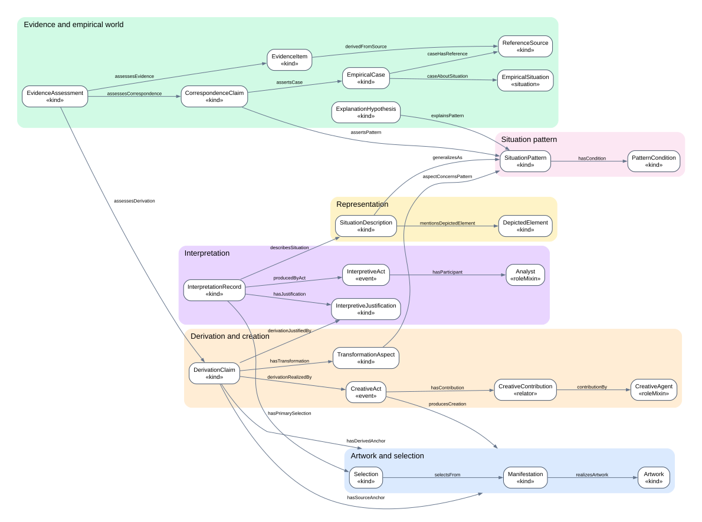

# Artistic Reality Ontology (ARO)

     

> 🇧🇷 **[Ler esta documentação em português](LEIA-ME.md)** · 🇺🇸 English (this page)

> ⚠️ **Beta — under development.** Version 0.2.0 is a research draft of a doctoral project (PPGInf/UFPR, see [affiliation](#academic-and-institutional-affiliation)); terms and files may still change.

**ARO** is an OWL ontology for describing **artworks in any medium** (music, text, image, video…) and what is said about them, in a traceable and contestable way:

- **what is interpreted** in a portion of a work, allowing divergent interpretations;
- **which situations the work represents** and which **patterns** those situations form;
- **which real cases resemble** those patterns, backed by sources and evidence;
- **how one work derives from another** (translation, cover, sampling, adaptation, parody, fan work…), what was retained or transformed, who created it and **why** the derivation is claimed.

ARO is a representation: it neither decides nor verifies anything. Interpretations, correspondences with reality and derivations are represented as **claims made by agents**, together with their justifications, sources and evidence assessments, which other agents may support or challenge. The ontology never asserts by itself that a claim is true, and the legality or originality of derivations is outside its scope.

---

## Contents

- [Documentation](#documentation)
- [How the ontology is organized](#how-the-ontology-is-organized)
- [Key principles](#key-principles)
- [Installation](#installation)
- [Using the ontology](#using-the-ontology)
- [Instantiating: step by step](#instantiating-step-by-step)
- [Validating and querying your data](#validating-and-querying-your-data)
- [Annotator (web tool)](#annotator-web-tool)
- [Format for annotation tools](#format-for-annotation-tools)
- [Running the tests](#running-the-tests)
- [Classes](#classes)
- [Languages](#languages)
- [Repository layout](#repository-layout)
- [Changing the model](#changing-the-model)
- [Academic and institutional affiliation](#academic-and-institutional-affiliation)
- [Status, license and citation](#status-license-and-citation)

---

## Documentation

Full documentation is available in both languages:

| Document | 🇺🇸 English | 🇧🇷 Português |
|---|---|---|
| Purpose and scope | [English](docs/en/purpose-and-scope.md) | [Português](docs/pt-BR/purpose-and-scope.md) |
| Requirements | [English](docs/en/requirements.md) | [Português](docs/pt-BR/requirements.md) |
| Competency questions | [English](docs/en/competency-questions.md) | [Português](docs/pt-BR/competency-questions.md) |
| Reference model (all classes, relations, vocabularies) | [English](docs/en/reference-model.md) | [Português](docs/pt-BR/reference-model.md) |
| Derivation typology and bibliography | [English](docs/en/derivation-typology.md) | [Português](docs/pt-BR/derivation-typology.md) |
| Foundation, mappings and limitations | [English](docs/en/foundation-and-mappings.md) | [Português](docs/pt-BR/foundation-and-mappings.md) |
| Design decisions (ADR-001 to ADR-024) | [English](docs/en/design-decisions.md) | [Português](docs/pt-BR/design-decisions.md) |
| Datatypes and validation | [English](docs/en/datatypes-and-validation.md) | [Português](docs/pt-BR/datatypes-and-validation.md) |
| Case studies (Homem na Estrada, Vidas Secas) | [English](docs/en/case-studies.md) | [Português](docs/pt-BR/case-studies.md) |
| Traceability | [English](docs/en/traceability.md) | [Português](docs/pt-BR/traceability.md) |
| SABiOx plan | [English](docs/en/sabiox-plan.md) | [Português](docs/pt-BR/sabiox-plan.md) |
| SABiOx compilation (everything by phase) | [English](docs/en/sabiox-compilation.md) | [Português](docs/pt-BR/sabiox-compilado.md) |
| Annotator manual (step by step) | [English](docs/en/annotator-manual.md) | [Português](docs/pt-BR/manual-anotador.md) |
| Annotator guide | [English](annotator/README.md#english) | [Português](annotator/README.md#português) |
| User guide (this file) | [English](README.md) | [Português](LEIA-ME.md) |
| Releases (frozen versions) | [English](releases/README.md) | [Português](releases/README.md) |
| Version history | [English](CHANGELOG.md) | — (English only) |

---

## How the ontology is organized

There are six modules (coloured boxes). Each arrow is an ontology relation; arrows ending at a box border point to any class of that module (for example, a derivation anchor may be an artwork, a manifestation or a selection). The [full diagram](model/diagrams/overview.svg) shows every class and relation.



| Module | Purpose | Diagram |
|---|---|---|
| **Artwork & selection** | Identify the work, its versions (recording, edition, cut) and addressable portions | [artwork](model/diagrams/artwork.svg) |
| **Interpretation** | Record interpretations of selections, who made them, their arguments, challenges and assessments | [interpretation](model/diagrams/interpretation.svg) |
| **Representation** | Describe represented situations, characters and intentional states | [representation](model/diagrams/representation.svg) |
| **Pattern** | Generalize situations into patterns reusable across works | [pattern](model/diagrams/pattern.svg) |
| **Evidence** | Link patterns to real cases through claims backed by sources and assessments | [evidence](model/diagrams/evidence.svg) |
| **Derivation** | State that a work/version/portion derives from another, how, what changed, who made it and why | [derivation](model/diagrams/derivation.svg) |

## Key principles

1. **A selection is not an interpretation.** The portion is an address; its meaning lives in a separate `InterpretationRecord`.
2. **Represented is not empirical.** The situation in the work (`SituationDescription`) is distinct from the real one (`EmpiricalSituation`).
3. **Interpretations may conflict** and coexist.
4. **Patterns are reusable** across independent works.
5. **Sources are independent and reusable**; each `EvidenceItem` represents a contextual extract, and an `EvidenceAssessment` represents an agent's judgment of whether it supports or challenges a **specific** claim.
6. **A correspondence claim represents similarity**, not identity or causation.
7. **Derivation is represented as a claim**, not as a fact; each hop of a derivation chain is a separate claim, and no transitivity axiom is declared.
8. **Derivative works are represented as creations in their own right**; legality and originality are outside the scope of the ontology.
9. **Agents come from outside**: people, bands and analysts are IRIs from other ontologies (schema.org, FOAF, Wikidata, PROV-O).

## Installation

Requirements: **Python 3.10+**. Optional: **Graphviz**, only to regenerate the SVG diagrams.

```bash
git clone <repository-url> artistic-reality-ontology
cd artistic-reality-ontology
python -m pip install -r requirements.txt
python tests/test_project.py
```

The last command should end with `PASS: ...`. Dependencies are `rdflib`, `jsonschema` and `pyshacl`.

## Using the ontology

| File | Use |
|---|---|
| [`ontology/src/aro.ttl`](ontology/src/aro.ttl) | Development version in Turtle (also [`aro.owl`](ontology/src/aro.owl) in RDF/XML and [`aro.jsonld`](ontology/src/aro.jsonld)); one file per package in [`ontology/src/modules/`](ontology/src/modules/) |
| [`releases/v0.2.0-beta/`](releases/v0.2.0-beta/) | **Frozen version to cite** (version IRI `https://w3id.org/aro/ontology/0.2.0-beta`); all versions in [`releases/`](releases/README.md) |
| [`validation/aro-shapes.ttl`](validation/aro-shapes.ttl) | SHACL constraints for validating data |
| [`schemas/derivation-annotation.schema.json`](schemas/derivation-annotation.schema.json) | JSON format for annotation tools |

- **Namespace:** `https://w3id.org/aro/ontology#` (prefix `aro:`).
- **Protégé or another OWL editor:** open `ontology/src/aro.ttl`. Choose rendering by label (language `en` or `pt-BR`) to see readable names.
- **Python:**

```python
from rdflib import Graph
g = Graph().parse("ontology/src/aro.ttl")
g.parse("my-data.ttl")
```

## Instantiating: step by step

The complete example is [`examples/quickstart.ttl`](examples/quickstart.ttl).

**1. Artwork, manifestation and selection.** The artwork is abstract; the manifestation is a concrete version; the selection points to a portion with a W3C Web Annotation selector (`t=` time, `xywh=` region, text quote or SVG).

```turtle
@prefix aro:    <https://w3id.org/aro/ontology#> .
@prefix oa:     <http://www.w3.org/ns/oa#> .
@prefix schema: <https://schema.org/> .
@prefix ex:     <https://example.org/my-project/> .

ex:song a aro:Artwork ; aro:textValue "Song A"@en, "Canção A"@pt-BR .
ex:song-rec a aro:Manifestation ; aro:realizesArtwork ex:song .
ex:riff a aro:Selection ; aro:selectsFrom ex:song-rec ; aro:hasSelector ex:riff-sel .
ex:riff-sel a oa:FragmentSelector ; oa:value "t=12,16" .
```

**2. Interpretation.** Anchored in a selection and produced by an act with a participant. The analyst is any external IRI.

```turtle
ex:me a schema:Person .
ex:act a aro:InterpretiveAct ; aro:hasParticipant ex:me .
ex:reading a aro:InterpretationRecord ;
  aro:hasPrimarySelection ex:riff ;
  aro:producedByAct ex:act ;
  aro:describesSituation ex:scene .
ex:scene a aro:SituationDescription ;
  aro:textValue "A character leaves home after a conflict."@en,
                "Uma personagem sai de casa após um conflito."@pt-BR .
```

**3. Derivation.** A new track samples the riff. The level (artwork, manifestation or selection) is chosen through the anchors; type, regime, dimension and operation are vocabulary concepts; the justification explains the claim.

```turtle
ex:track a aro:Artwork .
ex:track-rec a aro:Manifestation ; aro:realizesArtwork ex:track .
ex:loop a aro:Selection ; aro:selectsFrom ex:track-rec ; aro:hasSelector ex:loop-sel .
ex:loop-sel a oa:FragmentSelector ; oa:value "t=0,4" .

ex:claim a aro:DerivationClaim ;
  aro:hasSourceAnchor ex:riff ;
  aro:hasDerivedAnchor ex:loop ;
  aro:hasDerivationType aro:Sampling ;
  aro:hasRegime aro:PlayfulRegime ;
  aro:hasTransformation ex:aspect ;
  aro:derivationJustifiedBy ex:why .
ex:aspect a aro:TransformationAspect ;
  aro:hasDimension aro:RecordedSoundDimension ;
  aro:hasOperation aro:Recontextualized .
ex:why a aro:InterpretiveJustification ;
  aro:textValue "Same 4-second guitar riff, pitched up."@en,
                "Mesmo riff de guitarra de 4 segundos, mais agudo."@pt-BR .
```

**More examples:**
- [`examples/synthetic-derivation.ttl`](examples/synthetic-derivation.ttl): a cover with creative contributions, a novel-to-film adaptation that retains a pattern, a fan story → film → novel chain, sources and evidence assessment.
- [`examples/example_homem_na_estrada.ttl`](examples/example_homem_na_estrada.ttl) and [`examples/example_vidas_secas.ttl`](examples/example_vidas_secas.ttl): one file per work (generated by `scripts/split_examples.py`).
- [`examples/case-studies.ttl`](examples/case-studies.ttl): **real case studies** — *Homem na Estrada* (Racionais MC's) and *Vidas Secas* (Graciliano Ramos) with its film adaptation, linked to documented real cases and sources; see [case studies](docs/en/case-studies.md).
- [`examples/synthetic-data.ttl`](examples/synthetic-data.ttl): the full chain artwork → interpretation → pattern → real case → evidence.

**Where to find the concepts:** the values of `hasDerivationType`, `hasRegime`, `hasDimension`, `hasOperation` and `contributionRole` are summarized in the [vocabulary table](#classes) below and, with definitions and literature, in [docs/en/reference-model.md](docs/en/reference-model.md#controlled-vocabularies-skos).

## Validating and querying your data

```bash
python scripts/validate.py my-data.ttl
```

Prints `OK` or one line per violation (resource, property and message; add `--lang pt-BR` for Portuguese). Examples of reported errors: a derivation without a type, a source equal to the derived entity, an anchor that is not an artwork/manifestation/selection, text without a language tag.

```bash
python scripts/query.py my-data.ttl --query queries/CQ-13-derivations-of-work.rq
```

Runs a SPARQL query over your data plus the ontology. The ready-made queries in [`queries/`](queries/) answer the competency questions:

| Query | Question |
|---|---|
| CQ-05 | Which real cases have been claimed similar to a pattern? |
| CQ-06 | Which sources does a correspondence claim cite? |
| CQ-13 | What derives from a work, at which level and of which type? |
| CQ-14 | Which works are linked by derivation chains? |
| CQ-15 | What does each derivation retain, modify, add, remove or recontextualize? |
| CQ-16 | Which derivations retain a situation pattern of their source? |
| CQ-17 | How is each derivation explained (justifications, sources, assessments)? |
| CQ-18 | Who contributed to the derived creation, in which role? |
| RQ-01 | Which passages represent situations claimed to correspond to documented real cases, and where is the source? |
| RQ-02 | Which situation patterns recur across independent works? |
| RQ-03 | How is each correspondence supported (evidence, source, assessment)? |
| RQ-04 | Which derivations retain a source pattern that corresponds to real cases? |

## Annotator (web tool)

The [`annotator/`](annotator/README.md) folder contains a browser tool to instantiate ARO without writing Turtle:

```bash
python scripts/annotator.py
```

Create nodes of any class, link them with the properties the ontology allows (vocabulary concepts, W3C selectors and external agents included), write texts in several languages, add links to sources and evidence, search situations on Google, open the graph step by step, validate, and **save or load** your annotations as Turtle. Interface in English or Portuguese. See the [annotator manual](docs/en/annotator-manual.md) (step by step) and the [annotator guide](annotator/README.md) (quick reference).

## Running the tests

```bash
python tests/test_project.py
```

The output must end with `PASS: ...`. The tests check that the generated files match the catalog, that the three OWL serializations agree, that every term is labelled in English and Portuguese, the JSON Schemas and SHACL constraints (valid and deliberately invalid data), every SPARQL query, and the expected answers of the case studies. Details: [annotator manual, section 12](docs/en/annotator-manual.md#12-running-the-project-tests).

## Format for annotation tools

An annotator can produce JSON validated by [`schemas/derivation-annotation.schema.json`](schemas/derivation-annotation.schema.json): one derivation claim per document, with anchors and selectors, types, regimes, aspects and a justification in one or several languages (`{"en": "...", "pt-BR": "..."}`). Accepted values are generated from the ontology vocabularies. Example: [`examples/synthetic-derivation-annotation.json`](examples/synthetic-derivation-annotation.json).

## Classes

Overview generated from the catalog; the UFO column gives the OntoUML stereotype. For each class, [docs/en/reference-model.md](docs/en/reference-model.md) explains what the stereotype means in UFO, how the class is represented in OWL/TTL (with its Turtle), its SHACL constraints and what OWL cannot express.

<!-- BEGIN GENERATED: class overview (scripts/build.py) -->
#### `artwork` — Artwork and selection

| Class | Label | UFO | Definition |
|---|---|---|---|
| `Artwork` | artwork | «kind» | Identifiable artistic creation across media and manifestations. |
| `Manifestation` | manifestation | «kind» | Specific expression, version or realization of an artwork. |
| `Selection` | selection | «kind» | Addressable selected portion of a manifestation (not its physical component). |
| `AnalysisUnit` | analysis unit | «kind» | Intentional grouping of selections for analytical purposes. |

#### `interpretation` — Interpretation

| Class | Label | UFO | Definition |
|---|---|---|---|
| `InterpretationRecord` | interpretation record | «kind» | Persistent authored record of an interpretation of a selection. |
| `InterpretiveAct` | interpretive act | «event» | Temporal intentional activity yielding interpretation records. |
| `Analyst` | analyst | «roleMixin» | Any human agent, identified in an external vocabulary, insofar as they interpret or assess. Agent identity is represented by the external vocabulary, not by ARO. |
| `InterpretiveJustification` | interpretive justification | «kind» | Recorded argument connecting premises to an interpretation or to a derivation claim. |
| `InterpretationChallenge` | interpretation challenge | «kind» | Recorded criticism or alternative reasoning about an interpretation. |
| `InterpretationAssessment` | interpretation assessment | «kind» | Explicit epistemic or axiological judgment of an interpretation. |
| `AssessmentCriterion` | assessment criterion | «kind» | Specified epistemic or value-based assessment rule. |

#### `representation` — Representation

| Class | Label | UFO | Definition |
|---|---|---|---|
| `DepictedElement` | depicted element | «kind» | Information-level representation of a referent in an artwork. |
| `DepictedAgent` | depicted agent | «subkind» | Depicted element referring to an agent or character. |
| `SituationDescription` | situation description | «kind» | Recorded description of a represented situation. |
| `IntentionalStateDescription` | intentional state description | «subkind» | Situation description attributing desire, belief or intention to a depicted agent. |

#### `pattern` — Situation pattern

| Class | Label | UFO | Definition |
|---|---|---|---|
| `SituationPattern` | situation pattern | «kind» | Reusable informational specification of situation conditions. |
| `PatternCondition` | pattern condition | «kind» | Individuated mandatory or optional condition within a pattern. |

#### `evidence` — Evidence and empirical world

| Class | Label | UFO | Definition |
|---|---|---|---|
| `EmpiricalCase` | empirical case | «kind» | Documented dossier about one real-world situation or occurrence. |
| `EmpiricalClaim` | empirical claim | «kind» | Recorded testable claim about the empirical world. |
| `ReferenceSource` | reference source | «kind» | Citable external resource: news, study, report, legal document, testimony, dataset, etc. |
| `EvidenceItem` | evidence item | «kind» | Extracted contextual assertion or observation from a reference source. |
| `CorrespondenceClaim` | correspondence claim | «kind» | Contestable assertion of similarity, instantiation or explanatory relevance between pattern and empirical case. |
| `EvidenceAssessment` | evidence assessment | «kind» | Judgment whether evidence supports, challenges or is irrelevant to a specified claim. |
| `ExplanationHypothesis` | explanation hypothesis | «kind» | Proposed mechanism or factors explaining a represented or observed phenomenon. |
| `EmpiricalSituation` | empirical situation | «situation» | Configuration of entities and conditions in the real world. |
| `EmpiricalEvent` | empirical event | «event» | Real-world temporally bounded occurrence. |

#### `derivation` — Derivation and creation

| Class | Label | UFO | Definition |
|---|---|---|---|
| `DerivationClaim` | derivation claim | «kind» | Contestable assertion, made by an agent, that one artistic entity (artwork, manifestation or selection) derives from another in specified ways. The derived entity is represented as a creation in its own right; legality and originality are outside the scope of the ontology. |
| `TransformationAspect` | transformation aspect | «kind» | Recorded statement of what happened to one artistic dimension in a derivation (retained, modified, added, removed or recontextualized). |
| `CreativeAct` | creative act | «event» | Intentional temporal activity that brings an artwork or manifestation into existence, including derivative ones. |
| `CreativeAgent` | creative agent | «roleMixin» | Any agent, identified and described in an external vocabulary (PROV-O, FOAF, schema.org, Wikidata...), insofar as it contributes to a creative act. Agent identity is represented by the external vocabulary, not by ARO. |
| `CreativeContribution` | creative contribution | «relator» | Participation of one creative agent in one creative act under one or more roles. |
| `DerivationType` | derivation type | «type» | Kind of derivation (translation, cover, sampling, parody...); its instances are SKOS concepts. |
| `DerivationRegime` | derivation regime | «type» | Stance of a derivation toward its source (playful, satirical, serious, reverential); its instances are SKOS concepts. |
| `ArtisticDimension` | artistic dimension | «type» | Aspect of a work along which derivation can be compared (melody, lyrics, plot, character, medium...). |
| `TransformationOperation` | transformation operation | «type» | What a derivation does to a dimension: retain, modify, add, remove or recontextualize. |
| `CreativeRole` | creative role | «type» | Role qualifying a creative contribution (composer, performer, translator, remixer...). |

#### Controlled vocabularies (SKOS)

| Scheme | Concepts | Top level |
|---|---|---|
| `DerivationTypeScheme` — Derivation types | 40 | `Rerealization`, `Incorporation`, `Transformation`, `Imitation`, `Extension` |
| `ArtisticDimensionScheme` — Artistic dimensions | 56 | `NarrativeDimension`, `TextDimension`, `MusicDimension`, `VisualDimension`, `AudiovisualDimension`, `GeneralDimension`, `ParatextDimension` |
| `DerivationRegimeScheme` — Derivation regimes | 4 | `PlayfulRegime`, `SatiricalRegime`, `SeriousRegime`, `ReverentialRegime` |
| `TransformationOperationScheme` — Transformation operations | 5 | `Retained`, `Modified`, `Added`, `Removed`, `Recontextualized` |
| `CreativeRoleScheme` — Creative roles | 10 | `AuthorRole`, `ComposerRole`, `LyricistRole`, `PerformerRole`, `ArrangerRole`, `TranslatorRole`, `AdapterRole`, `ProducerRole`, `DirectorRole`, `RemixerRole` |
<!-- END GENERATED: class overview -->

## Languages

- **English terms:** all IRIs (`aro:Artwork`, `aro:hasSourceAnchor`…).
- **Complete Portuguese translation:** every class, property, concept and validation message has a label, definition and comment in `@en` and `@pt-BR`.
- **Content in any language:** texts in your data (`aro:textValue`, `aro:derivationExtent`) must carry a language tag, e.g. `"..."@es`, and may have one value per language. Untagged text is rejected by validation.

## Repository layout

| Folder / file | Contents |
|---|---|
| `ontology/src/` | development version of the ontology (Turtle, RDF/XML, JSON-LD) and `modules/` per package — generated |
| `releases/` | frozen versions (`v0.1.0/`, `v0.2.0-beta/`…), each with ontology, modules, SHACL and release notes |
| `validation/` | SHACL constraints — generated |
| `schemas/` | JSON Schemas (reference source, generic record, derivation annotation) |
| `examples/` | synthetic example data, all fictional |
| `queries/` | SPARQL queries for the competency questions |
| `annotator/` | web annotator (graph view, save/load Turtle) |
| `scripts/` | `build.py` (generates artifacts), `validate.py`, `query.py`, `annotator.py`, `split_examples.py` |
| `model/` | conceptual catalog (single source of truth) and diagrams |
| `docs/` | full documentation in `en/` and `pt-BR/` |
| `tests/` | automated verification |

## Changing the model

[`model/conceptual-model.json`](model/conceptual-model.json) is the **single source of truth**. To add a class, relation or concept:

1. edit the catalog (the `$comment` at the top explains every field);
2. run `python scripts/build.py`, which regenerates the ontology, SHACL, schemas, reference documentation, diagrams and the [Classes](#classes) section of this file;
3. run `python tests/test_project.py`.

Never edit files marked as generated by hand.

## Academic and institutional affiliation

This project is part of the research activities of the PhD in Informatics of **Jefferson Rodrigo Speck**, doctoral student in the Graduate Program in Informatics (PPGInf) of the Federal University of Paraná (UFPR), supervised by **Prof. Dr. Roberto Pereira** (UFPR) and co-supervised by **Prof. Dr. Clodis Boscarioli** (UNIOESTE), linked to the Research Group on Technology and Innovation in Education (GTIE) of the Western Paraná State University (UNIOESTE).

The doctoral research investigates the computational modelling of ethics and morality, considering the limits of knowledge representation, the incompleteness of models, the dimensions that are unknown to or excluded from representation, and their implications for the development and use of computational systems, especially those based on Artificial Intelligence.

## Status, license and citation

- **Status:** **beta, under development** (v0.2.0) — research draft, developed with the SABiOx methodology and grounded in UFO. OntoUML stereotypes are provisional; there has been no expert validation or real-case evaluation yet. See [limitations](docs/en/foundation-and-mappings.md#known-limitations).
- **License:** MIT ([LICENSE](LICENSE)). Third-party ontologies are not redistributed.
- **Citation** ([CITATION.cff](CITATION.cff), no DOI yet):
  > Speck, J. R. (2026). *Artistic Reality Ontology (ARO)* (Version 0.2.0-beta) [Ontology and software]. Doctoral project, Graduate Program in Informatics, Federal University of Paraná (UFPR). Supervisor: R. Pereira; co-supervisor: C. Boscarioli.
- **Examples:** synthetic examples are fictional. The case studies use real works and sources, but the readings are an analyst's interpretations, and the correspondences are claims, not facts.
