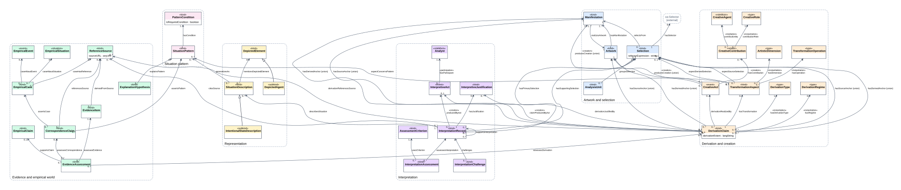
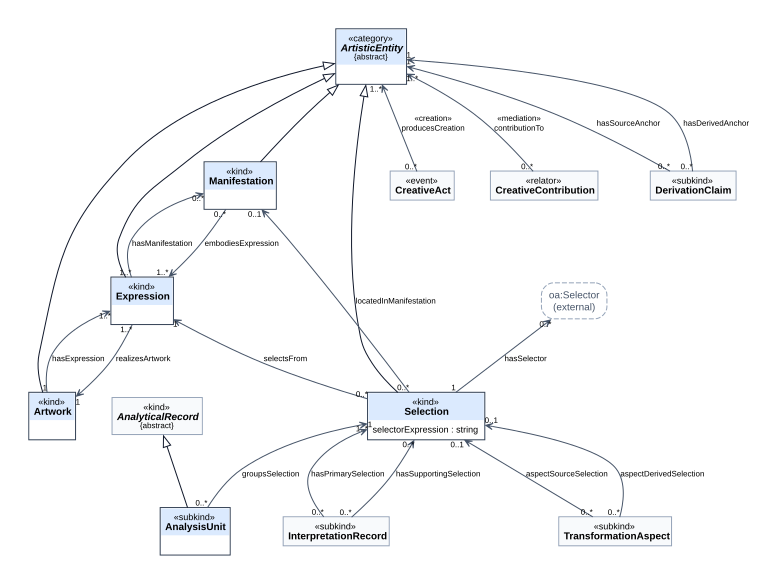
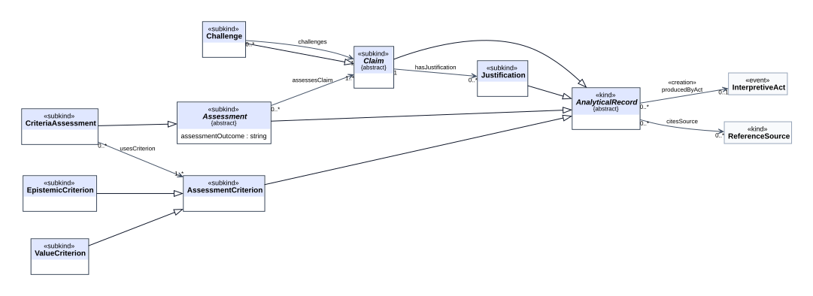
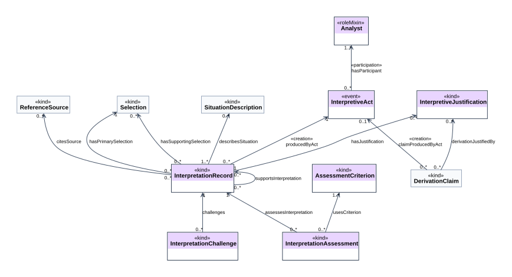
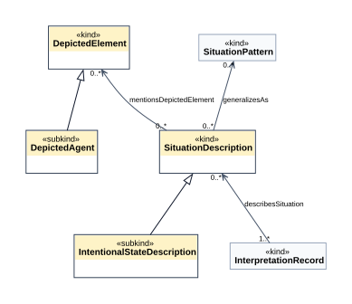
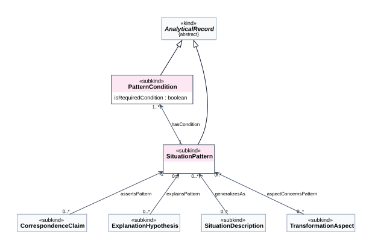
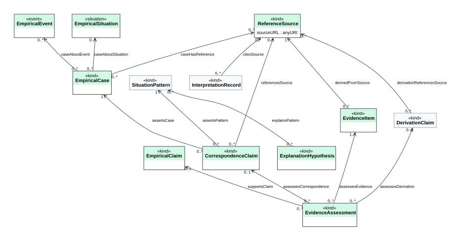
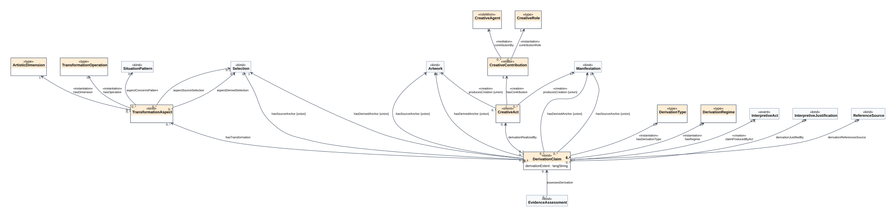
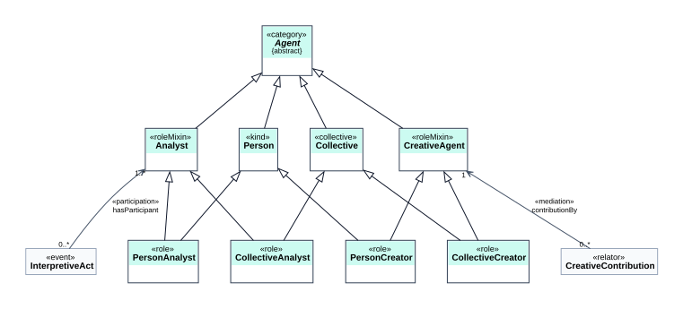

[← Back to README](../../README.md) · [Português](../pt-BR/ontouml.md)

# ARO OntoUML diagrams

UML class diagrams in OntoUML notation, generated by `scripts/build.py` from the catalog [`model/conceptual-model.json`](../../model/conceptual-model.json). Files: [`model/diagrams/ontouml/`](../../model/diagrams/ontouml/) (`.dot`, `.svg` and `.png` at 200 dpi for documents and slides).

> **Status:** views of ARO in OntoUML notation, with **provisional** stereotypes. They are not yet an OntoUML exchange file and have not been checked in an OntoUML editor (ADR-009). The choices below are justified for expert review.

## How to read

| Element | Notation |
|---|---|
| Class | box with `«stereotype»` above the name; second compartment with attributes (datatype properties whose domain is the class) |
| Association | open arrow in the direction of the OWL property; label `«stereotype»` (when one applies) + name; multiplicities at both ends |
| Generalization | line with a hollow triangle pointing to the superclass |
| *Italic* name and `{abstract}` | abstract class: a «category» or a class fully divided into subkinds; it has no direct instances (in OWL, `owl:disjointUnionOf` its subkinds) |
| Grey generalization (overview) | the subclass is in another package (most analytical records specialize `AnalyticalRecord`) |
| Dashed "(external)" box | class from another vocabulary (e.g. `oa:Selector`) |
| Faded box in package diagrams | class of another package, shown as context |

## Overview

## Per package

| Package | Diagram |
|---|---|
| Artwork and selection |  |
| Claims and records |  |
| Interpretation |  |
| Representation |  |
| Situation pattern |  |
| Evidence and empirical world |  |
| Derivation and creation |  |
| Agents |  |

## Class stereotypes

What each stereotype means in UFO, how it is projected into OWL and what OWL cannot express is in the table of the [reference model](reference-model.md#how-ufo-stereotypes-are-represented-in-owl). Summary (0.3): 7 «kind», 24 «subkind», 1 «collective», 2 «category», 2 «roleMixin», 4 «role», 3 «event», 1 «situation», 1 «relator», 5 «type».

**Top-level structure (ADR-027).** Each individual instantiates exactly one ultimate sortal, which supplies its identity:

| Ultimate sortal | Stereotype | What it covers |
|---|---|---|
| `Artwork`, `Expression`, `Manifestation`, `Selection` | «kind», generalized by the «category» `ArtisticEntity` | the IFLA LRM levels of an artistic creation and its addressable portions (ADR-028) |
| `AnalyticalRecord` | «kind», abstract | every record made in an analysis; its «subkind»s are the interpretations, descriptions, patterns, conditions, cases, evidence items, transformation aspects, justifications, assessments and `Claim` (itself abstract, divided into the six kinds of claim, ADR-026) |
| `ReferenceSource` | «kind» | citable external resources, not made by the analysis |
| `Person`, `Collective` | «kind», «collective», generalized by the «category» `Agent` | agents, identified by external IRIs (ADR-029) |
| `InterpretiveAct`, `CreativeAct`, `EmpiricalEvent` | «event» | occurrences in time, with `startDate`/`endDate` (ADR-030) |
| `EmpiricalSituation` | «situation» | real-world states of affairs |
| `CreativeContribution` | «relator» | an agent's contribution to an artistic entity |
| `DerivationType`, `DerivationRegime`, `ArtisticDimension`, `TransformationOperation`, `CreativeRole` | «type» | high-order types whose instances are SKOS concepts |

These ultimate sortals are declared pairwise disjoint (`owl:AllDisjointClasses`), and the tests check with an OWL RL reasoner that the examples respect them.

## Association stereotypes

| Association | Stereotype | Rationale |
|---|---|---|
| `hasParticipant` (InterpretiveAct → Analyst) | «participation» | the analyst participates in the interpretive event |
| `producedByAct` (Claim → InterpretiveAct) | «creation» | the analytical act creates the claim (any kind of claim) |
| `producesCreation` (CreativeAct → ArtisticEntity) | «creation» | the creative act brings the artwork, expression or manifestation into existence |
| `hasContribution` (CreativeAct → CreativeContribution) | «creation» | the contribution relator is founded by the creative act |
| `contributionBy` (CreativeContribution → CreativeAgent) | «mediation» | the relator is existentially dependent on the agent it mediates |
| `contributionTo` (CreativeContribution → ArtisticEntity) | «mediation» | ...and on the artistic entity contributed to: the relator now mediates two entities (ADR-030) |
| `contributionRole`, `hasDerivationType`, `hasRegime`, `hasDimension`, `hasOperation` | «instantiation» (provisional) | link to a high-order type; in OWL the concepts are SKOS individuals, so multi-level instantiation is approximated |
| all other associations | no stereotype | relations between information objects (UFO-C) that are neither formal relations nor modelled relators (e.g. `assertsPattern`, `selectsFrom`) |

## Validation of the OntoUML model (ADR-009, ADR-032)

The model is exported as an OntoUML project in the official exchange format: [`model/ontouml/aro.ontouml.json`](../../model/ontouml/aro.ontouml.json), generated by `scripts/build.py` (classes with stereotypes, abstractness and nature, generalizations, associations with stereotypes and multiplicities). It is checked in two ways:

| Check | Tool | Result |
|---|---|---|
| Syntax: conformance to the official **OntoUML JSON Schema 1.0.2** | `python scripts/verify_ontouml.py` (schema copied in `model/ontouml/`) | **valid** |
| Well-formedness: every class has an OntoUML stereotype; each subkind/role specializes exactly one ultimate sortal; no ultimate sortal under another; no rigid type under an anti-rigid one; non-sortals are abstract, specialize no sortal and are specialized by sortals; roles have a relational dependency; events and endurants are not mixed in generalizations; relators mediate at least two entities; «mediation», «participation», «creation» and «instantiation» connect the right kinds of classes | `python scripts/verify_ontouml.py`; the same rules evaluated with the official **ontouml-js 1.0.0** library in `scripts/verify_ontouml.mjs` | **0 errors**, 33 warnings |
| The verifier detects errors | the tests break a copy of the model (a kind under a kind, a relator with one mediation, a non-abstract category) | all reported |

The 33 warnings are associations without an OntoUML relation stereotype, e.g. `selectsFrom`, `assertsPattern`, `assessesClaim`. They link information objects (records, claims, artistic entities) through relations that are neither founded on a relator («material»), nor parthood, nor participation in an event; OntoUML has no stereotype that fits them, and forcing one would assert a commitment ARO does not make. They are kept as plain associations (ADR-032).

Still to do (ADR-009): open the JSON in an OntoUML editor (e.g. the Visual Paradigm plugin) to lay out the diagram and run that tool's own verification.

## Review status for valid OntoUML

Resolved in 0.3:

1. ~~**Union ranges**~~ — replaced by the «category» `ArtisticEntity` (derivation anchors, `producesCreation`, `contributionTo`); no relation has a union range any more.
2. ~~**«roleMixin» without specialized roles**~~ — `Analyst` and `CreativeAgent` specialize the «category» `Agent` and are specialized by the «role»s `PersonAnalyst`, `CollectiveAnalyst`, `PersonCreator` and `CollectiveCreator` of the sortals `Person` («kind») and `Collective` («collective»).
3. ~~**«relator» with a single modelled relatum**~~ — `CreativeContribution` mediates the agent (`contributionBy`) and the artistic entity (`contributionTo`).
4. ~~**Many informational «kind»s**~~ — the 22 informational kinds became «subkind»s of one «kind», `AnalyticalRecord`; claims share the abstract «subkind» `Claim`.
5. ~~**Events without time**~~ — `startDate`/`endDate` on acts, empirical events and situations.

Still open:

1. **«instantiation» over SKOS concepts:** the vocabularies are kept as high-order types (multi-level: each concept is an instance of a «type» class and a `skos:Concept`); in OWL 2 DL this is approximated by punning-free individuals.
2. **External classes** (`oa:Selector`): kept outside the OntoUML model, as references.
3. **Tool check (ADR-009):** the official JSON is exported, schema-valid and well formed (section above); opening it in an OntoUML editor for layout and that tool's own checks remains.

---

[← Back to README](../../README.md) · [Português](../pt-BR/ontouml.md)
