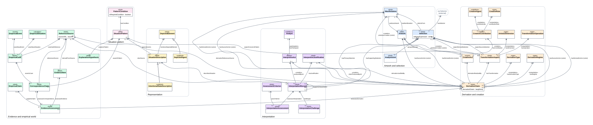
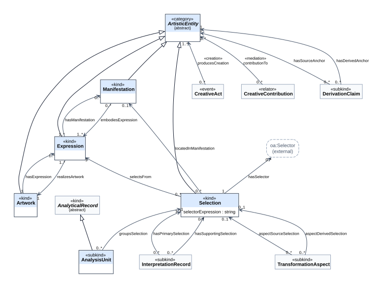
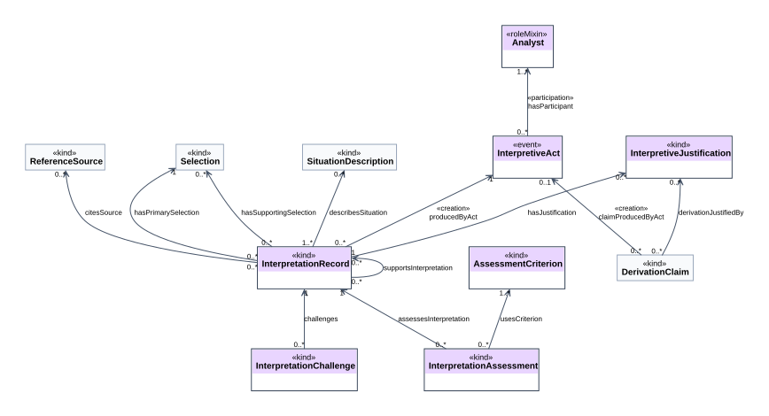
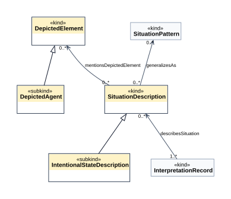
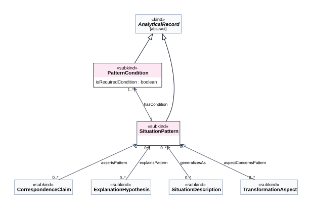
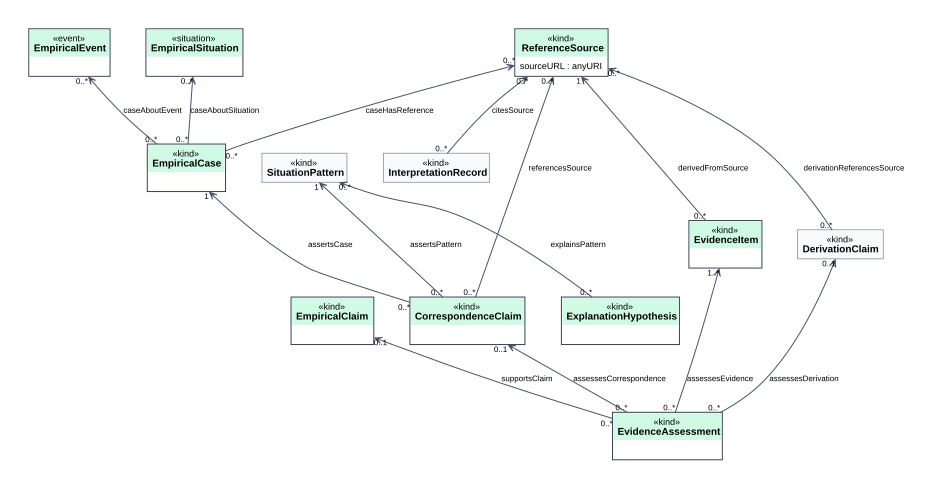
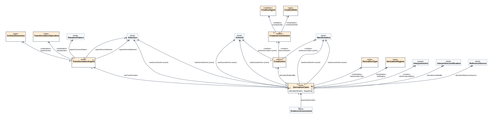

[← Voltar para o LEIA-ME](../../LEIA-ME.md) · [English](../en/ontouml.md)

# Diagramas OntoUML da ARO

Diagramas de classes UML com a notação OntoUML, gerados pelo `scripts/build.py` a partir do catálogo [`model/conceptual-model.json`](../../model/conceptual-model.json). Arquivos: [`model/diagrams/ontouml/`](../../model/diagrams/ontouml/) (`.dot`, `.svg` e `.png` a 200 dpi para documentos e slides).

> **Status:** visualizações da ARO em notação OntoUML, com estereótipos **provisórios**. Ainda não são um arquivo de intercâmbio OntoUML nem foram verificadas num editor OntoUML (ADR-009). As escolhas abaixo estão justificadas para revisão por especialistas.

## Como ler

| Elemento | Notação |
|---|---|
| Classe | caixa com `«estereótipo»` acima do nome; segundo compartimento com os atributos (propriedades de dados com domínio na classe) |
| Associação | seta aberta na direção da propriedade OWL; rótulo `«estereótipo»` (quando há um) + nome; multiplicidades nas duas pontas |
| Generalização | linha com triângulo vazado apontando para a superclasse |
| `{union}` | a imagem da propriedade é a união de várias classes (ex.: âncora de derivação = obra, manifestação ou recorte); desenhada como uma associação para cada classe |
| Caixa tracejada "(external)" | classe de outro vocabulário (ex.: `oa:Selector`) |
| Caixa clara nos diagramas de pacote | classe de outro pacote, mostrada como contexto |

## Visão geral

## Por pacote

| Pacote | Diagrama |
|---|---|
| Obra e recorte |  |
| Interpretação |  |
| Representação |  |
| Padrão situacional |  |
| Evidência e mundo empírico |  |
| Derivação e criação |  |

## Estereótipos de classe

O significado de cada estereótipo na UFO, como é projetado em OWL e o que o OWL não expressa estão na tabela do [modelo de referência](reference-model.md#como-os-estereótipos-ufo-são-representados-em-owl). Resumo: 22 «kind», 2 «subkind», 3 «event», 1 «situation», 1 «relator», 2 «roleMixin», 5 «type».

## Estereótipos de associação

| Associação | Estereótipo | Justificativa |
|---|---|---|
| `hasParticipant` (InterpretiveAct → Analyst) | «participation» | o analista participa do evento interpretativo |
| `producedByAct` (InterpretationRecord → InterpretiveAct) | «creation» | o ato interpretativo cria o registro |
| `claimProducedByAct` (DerivationClaim → InterpretiveAct) | «creation» | o ato analítico cria a alegação de derivação |
| `producesCreation` (CreativeAct → Artwork ∪ Manifestation) | «creation» | o ato criativo faz surgir a obra ou a manifestação |
| `hasContribution` (CreativeAct → CreativeContribution) | «creation» | o relator de contribuição é fundado pelo ato criativo |
| `contributionBy` (CreativeContribution → CreativeAgent) | «mediation» | o relator depende existencialmente do agente que media |
| `contributionRole`, `hasDerivationType`, `hasRegime`, `hasDimension`, `hasOperation` | «instantiation» (provisório) | ligam a um tipo de alta ordem; em OWL os conceitos são indivíduos SKOS, então a instanciação multinível é aproximada |
| demais associações | sem estereótipo | relações entre objetos informacionais (UFO-C) que não correspondem a relações formais nem a relatores modelados (ex.: `assertsPattern`, `selectsFrom`) |

## O que precisa de revisão para ser OntoUML válido

1. **Uniões de imagem** (`hasSourceAnchor`, `hasDerivedAnchor`, `producesCreation`): em OntoUML se modelariam com uma «category» comum (ex.: *DerivationAnchor*) generalizando `Artwork`, `Manifestation` e `Selection`.
2. **«roleMixin» sem papéis especializados:** `CreativeAgent` e `Analyst` recebem agentes de ontologias externas. Em OntoUML, um «roleMixin» deve ser especializado por «role»s de kinds concretos (ex.: *Person*, *Collective*).
3. **«relator» com um único relatum modelado:** `CreativeContribution` media o agente e é criado pelo ato. Uma «material» derivada (*contributesTo*) poderia ser explicitada.
4. **«instantiation» sobre conceitos SKOS:** é preciso revisar se os vocabulários ficam como tipos de alta ordem (multinível) ou como enumerações.
5. **Muitos «kind» informacionais:** convém verificar se alguns são «subkind» ou «role» de um *InformationObject* comum.
6. **Classes externas** (`oa:Selector`): ficam fora do modelo OntoUML, como referência.

O próximo passo é importar o modelo num editor OntoUML (ex.: o plugin OntoUML para Visual Paradigm), aplicar a verificação de boa formação e exportar o JSON oficial (ADR-009).

---

[← Voltar para o LEIA-ME](../../LEIA-ME.md) · [English](../en/ontouml.md)
