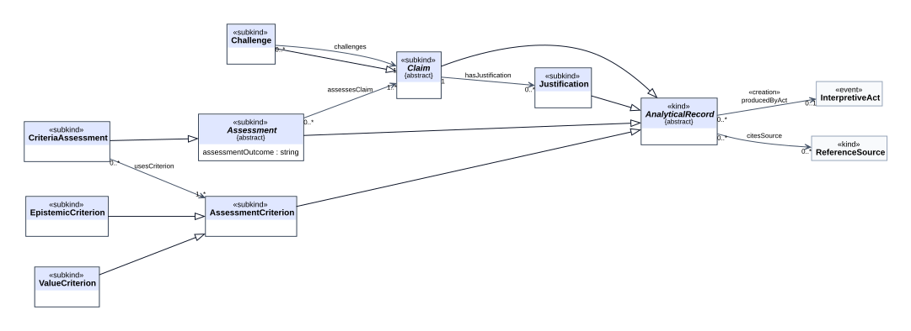
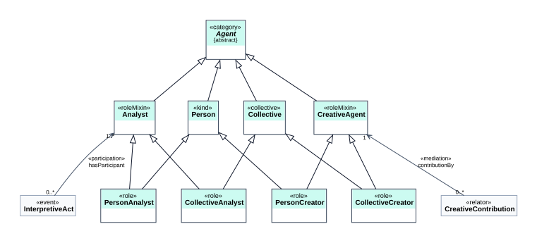

[← Voltar para o LEIA-ME](../../LEIA-ME.md) · [English](../en/ontouml.md)

# Diagramas OntoUML da ARO

Diagramas de classes UML com a notação OntoUML, gerados pelo `scripts/build.py` a partir do catálogo [`model/conceptual-model.json`](../../model/conceptual-model.json). Arquivos: [`model/diagrams/ontouml/`](../../model/diagrams/ontouml/) (`.dot`, `.svg` e `.png` a 200 dpi para documentos e slides).

> **Status:** visualizações da ARO em notação OntoUML, com estereótipos **provisórios**. Ainda não são um arquivo de intercâmbio OntoUML nem foram verificadas num editor OntoUML (ADR-009). As escolhas abaixo estão justificadas para revisão por especialistas.

## Como ler

| Elemento | Notação |
|---|---|
| Classe | caixa com `«estereótipo»` acima do nome; segundo compartimento com os atributos (propriedades de dados com domínio na classe) |
| Associação | seta aberta na direção da propriedade OWL; rótulo `«estereótipo»` (quando há um) + nome; multiplicidades nas duas pontas |
| Generalização | linha com triângulo vazado apontando para a superclasse |
| Nome em *itálico* e `{abstract}` | classe abstrata: uma «category» ou uma classe inteiramente dividida em subkinds; não tem instâncias diretas (em OWL, `owl:disjointUnionOf` seus subkinds) |
| Generalização cinza (visão geral) | a subclasse está em outro pacote (a maioria dos registros analíticos especializa `AnalyticalRecord`) |
| Caixa tracejada "(external)" | classe de outro vocabulário (ex.: `oa:Selector`) |
| Caixa clara nos diagramas de pacote | classe de outro pacote, mostrada como contexto |

## Visão geral

## Por pacote

| Pacote | Diagrama |
|---|---|
| Obra e recorte |  |
| Alegações e registros |  |
| Interpretação |  |
| Representação |  |
| Padrão situacional |  |
| Evidência e mundo empírico |  |
| Derivação e criação |  |
| Agentes |  |

## Estereótipos de classe

O significado de cada estereótipo na UFO, como é projetado em OWL e o que o OWL não expressa estão na tabela do [modelo de referência](reference-model.md#como-os-estereótipos-ufo-são-representados-em-owl). Resumo (0.3): 7 «kind», 24 «subkind», 1 «collective», 2 «category», 2 «roleMixin», 4 «role», 3 «event», 1 «situation», 1 «relator», 5 «type».

**Estrutura de topo (ADR-027).** Cada indivíduo instancia exatamente um sortal último, que fornece sua identidade:

| Sortal último | Estereótipo | O que abrange |
|---|---|---|
| `Artwork`, `Expression`, `Manifestation`, `Selection` | «kind», generalizados pela «category» `ArtisticEntity` | os níveis do IFLA LRM de uma criação artística e seus trechos endereçáveis (ADR-028) |
| `AnalyticalRecord` | «kind», abstrato | todo registro feito numa análise; seus «subkind»s são interpretações, descrições, padrões, condições, casos, itens de evidência, aspectos de transformação, justificativas, avaliações e `Claim` (também abstrata, dividida nos seis tipos de alegação, ADR-026) |
| `ReferenceSource` | «kind» | recursos externos citáveis, não feitos pela análise |
| `Person`, `Collective` | «kind», «collective», generalizados pela «category» `Agent` | agentes, identificados por IRIs externos (ADR-029) |
| `InterpretiveAct`, `CreativeAct`, `EmpiricalEvent` | «event» | ocorrências no tempo, com `startDate`/`endDate` (ADR-030) |
| `EmpiricalSituation` | «situation» | estados de coisas do mundo real |
| `CreativeContribution` | «relator» | a contribuição de um agente para uma entidade artística |
| `DerivationType`, `DerivationRegime`, `ArtisticDimension`, `TransformationOperation`, `CreativeRole` | «type» | tipos de alta ordem cujas instâncias são conceitos SKOS |

Esses sortais últimos são declarados disjuntos dois a dois (`owl:AllDisjointClasses`), e os testes verificam com um raciocinador OWL RL que os exemplos os respeitam.

## Estereótipos de associação

| Associação | Estereótipo | Justificativa |
|---|---|---|
| `hasParticipant` (InterpretiveAct → Analyst) | «participation» | o analista participa do evento interpretativo |
| `producedByAct` (Claim → InterpretiveAct) | «creation» | o ato analítico cria a alegação (qualquer tipo de alegação) |
| `producesCreation` (CreativeAct → ArtisticEntity) | «creation» | o ato criativo faz surgir a obra, a expressão ou a manifestação |
| `hasContribution` (CreativeAct → CreativeContribution) | «creation» | o relator de contribuição é fundado pelo ato criativo |
| `contributionBy` (CreativeContribution → CreativeAgent) | «mediation» | o relator depende existencialmente do agente que media |
| `contributionTo` (CreativeContribution → ArtisticEntity) | «mediation» | ...e da entidade artística para a qual contribui: o relator agora media duas entidades (ADR-030) |
| `contributionRole`, `hasDerivationType`, `hasRegime`, `hasDimension`, `hasOperation` | «instantiation» (provisório) | ligam a um tipo de alta ordem; em OWL os conceitos são indivíduos SKOS, então a instanciação multinível é aproximada |
| demais associações | sem estereótipo | relações entre objetos informacionais (UFO-C) que não correspondem a relações formais nem a relatores modelados (ex.: `assertsPattern`, `selectsFrom`) |

## Validação do modelo OntoUML (ADR-009, ADR-032)

O modelo é exportado como projeto OntoUML no formato oficial de intercâmbio: [`model/ontouml/aro.ontouml.json`](../../model/ontouml/aro.ontouml.json), gerado pelo `scripts/build.py` (classes com estereótipos, abstração e natureza, generalizações, associações com estereótipos e multiplicidades). Ele é verificado de duas formas:

| Verificação | Ferramenta | Resultado |
|---|---|---|
| Sintaxe: conformidade com o **JSON Schema oficial da OntoUML 1.0.2** | `python scripts/verify_ontouml.py` (schema copiado em `model/ontouml/`) | **válido** |
| Boa formação: toda classe tem estereótipo OntoUML; cada subkind/role especializa exatamente um sortal último; nenhum sortal último sob outro; nenhum tipo rígido sob um anti-rígido; não-sortais são abstratos, não especializam sortais e são especializados por sortais; papéis têm dependência relacional; eventos e endurantes não se misturam em generalizações; relatores mediam ao menos duas entidades; «mediation», «participation», «creation» e «instantiation» ligam os tipos certos de classe | `python scripts/verify_ontouml.py`; as mesmas regras avaliadas com a biblioteca oficial **ontouml-js 1.0.0** em `scripts/verify_ontouml.mjs` | **0 erros**, 33 avisos |
| O verificador detecta erros | os testes quebram uma cópia do modelo (kind sob kind, relator com uma mediação, categoria não abstrata) | todos apontados |

Os 33 avisos são associações sem estereótipo de relação OntoUML, ex.: `selectsFrom`, `assertsPattern`, `assessesClaim`. Elas ligam objetos informacionais (registros, alegações, entidades artísticas) por relações que não se fundam num relator («material»), nem são parte-todo, nem participação num evento; a OntoUML não tem estereótipo que lhes sirva, e forçar um afirmaria um compromisso que a ARO não assume. Ficam como associações simples (ADR-032).

Falta (ADR-009): abrir o JSON num editor OntoUML (ex.: plugin para Visual Paradigm) para diagramar e rodar a verificação própria da ferramenta.

## Situação da revisão para OntoUML válido

Resolvido na 0.3:

1. ~~**Uniões de imagem**~~ — substituídas pela «category» `ArtisticEntity` (âncoras de derivação, `producesCreation`, `contributionTo`); nenhuma relação tem mais imagem em união.
2. ~~**«roleMixin» sem papéis especializados**~~ — `Analyst` e `CreativeAgent` especializam a «category» `Agent` e são especializados pelos «role»s `PersonAnalyst`, `CollectiveAnalyst`, `PersonCreator` e `CollectiveCreator` dos sortais `Person` («kind») e `Collective` («collective»).
3. ~~**«relator» com um único relatum modelado**~~ — `CreativeContribution` media o agente (`contributionBy`) e a entidade artística (`contributionTo`).
4. ~~**Muitos «kind» informacionais**~~ — os 22 kinds informacionais viraram «subkind»s de um único «kind», `AnalyticalRecord`; as alegações compartilham o «subkind» abstrato `Claim`.
5. ~~**Eventos sem tempo**~~ — `startDate`/`endDate` em atos, eventos e situações empíricas.

Ainda em aberto:

1. **«instantiation» sobre conceitos SKOS:** os vocabulários ficam como tipos de alta ordem (multinível: cada conceito é instância de uma classe «type» e um `skos:Concept`); em OWL 2 DL isso é aproximado por indivíduos.
2. **Classes externas** (`oa:Selector`): ficam fora do modelo OntoUML, como referência.
3. **Verificação em ferramenta (ADR-009):** o JSON oficial é exportado, válido no schema e bem formado (seção acima); falta abri-lo num editor OntoUML para diagramar e rodar as verificações próprias da ferramenta.

---

[← Voltar para o LEIA-ME](../../LEIA-ME.md) · [English](../en/ontouml.md)
